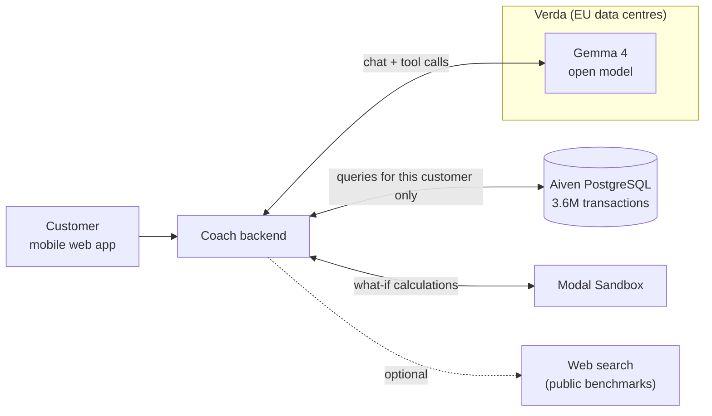
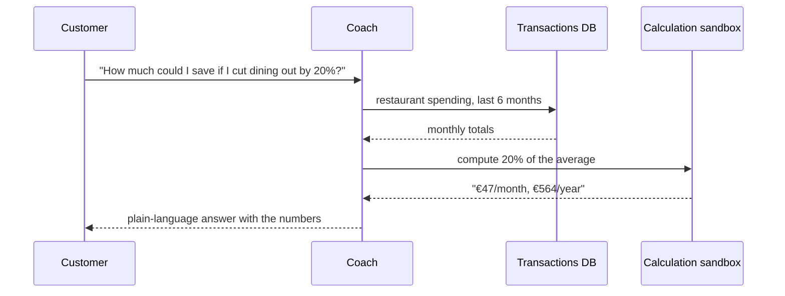

# mountain-claude-boys-trek

**An AI money coach that lets you chat with your own banking data.** Built by team Mountain Claude Boys for the Junction 2026 S-Pankki challenge, *Personal Economic Trainer*.

> 🚧 Work in progress during the hackathon. This README describes the product for graders and will be finalised before submission.

## The problem

Banking apps stop at statements and transaction lists. S-Bank asked for an AI experience where people can **talk with their own money**: from simple questions like *"How much did I spend on taxis last month?"* to deeper ones like *"What kind of spender am I?"*, *"What is safe for me to spend this week?"* or *"How much could I save if I reduced dining out by 20%?"*

Full brief: [CHALLENGE.md](CHALLENGE.md)

## What our coach does

- **Answers questions about your own transactions** in plain language, in Finnish or English.
- **Teaches S-Bank's three spending baskets**, placing every purchase by merchant type:
  1. 🏠 Regular essentials / Välttämättömät menot (rent, bills, groceries, public transport),
  2. 🔧 Unexpected necessities / Yllättävät menot (the dentist, a broken washing machine),
  3. ☕ Everyday spending / Arjen kulutus (coffees, takeaway, taxis).
- **A monthly budget and safe to spend this week:** income minus essentials, a reserve for surprises and usual savings gives the everyday budget; the coach tells you what's left this week and checks your account can cover the bills before payday.
- **"What kind of spender am I?":** compares your spending with people your age (Statistics Finland's age bands) and with everyone, per category and per basket: "you spend less on travel than 85% of people aged 18–24". Only medians and ranks are used, never another customer's data.
- **Computes, doesn't guess:** every number comes from code run on your own transactions; the AI only explains it.
- **Keeps customer data in Europe** by running Google's open Gemma 4 model on our own server at Verda, instead of sending it to an outside AI service.
- **Optional benchmarks** from open sources such as Statistics Finland, without ever sending personal data to a search engine.

## How it works

When a customer asks a question, the AI model decides which data it needs, queries **only that customer's** transactions, runs any calculation in a secure sandbox, and explains the result in plain language. It never sees the full dataset.

## Built with

| Technology | Role |
|---|---|
| **Gemma 4 31B** on **Verda** | The coach's AI model, self-hosted with vLLM on an H100 |
| **Aiven PostgreSQL** | The S-Pankki synthetic dataset: 5,100 customers, 3.6M transactions |
| **Modal** | Secure sandboxes for what-if and safe-to-spend calculations *(planned)* |
| **Claude** | Development and quality baseline |
| **Exa** | Optional web search for public benchmarks |

More detail: [TECH_STACK.md](TECH_STACK.md)

## Running it

See [SETUP.md](SETUP.md).

## Team

Mountain Claude Boys, Junction 2026.
