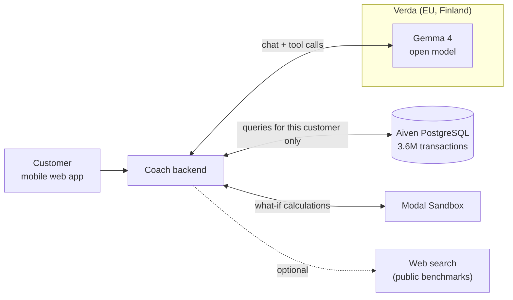
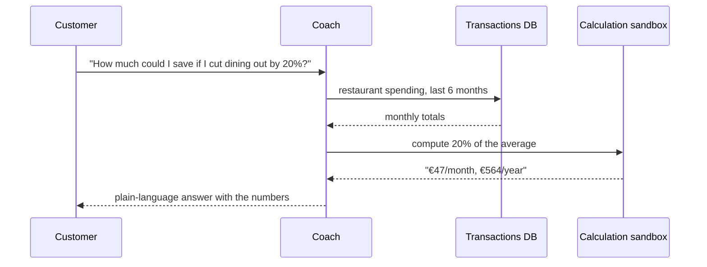

# mountain-claude-boys-trek

**An AI money coach that lets you chat with your own banking data.** Built by team Mountain Claude Boys for the Junction 2026 S-Pankki challenge, *Personal Economic Trainer*.

> 🚧 Work in progress during the hackathon. This README describes the product for graders and will be finalised before submission.

## The problem

Banking apps stop at statements and transaction lists. S-Bank asked for an AI experience where people can **talk with their own money**: from simple questions like *"How much did I spend on taxis last month?"* to deeper ones like *"What kind of spender am I?"*, *"What is safe for me to spend this week?"* or *"How much could I save if I reduced dining out by 20%?"*

Full brief: [CHALLENGE.md](CHALLENGE.md)

## What our coach does

- **Answers questions about your own transactions** in plain language, in Finnish or English.
- **Teaches S-Bank's three spending baskets**, placing every purchase by merchant type:
  1. 🏠 Regular essentials / Välttämättömät menot (rent, bills, groceries, public transport),
  2. 🔧 Unexpected necessities / Yllättävät menot (the dentist, a broken washing machine),
  3. ☕ Everyday spending / Arjen kulutus (coffees, takeaway, taxis).
- **A monthly budget and safe to spend this week:** income minus essentials, a reserve for surprises and usual savings gives the everyday budget; the coach tells you what's left this week and checks your account can cover the bills before payday.
- **"What kind of spender am I?":** compares your spending with people your age (Statistics Finland's age bands) and with everyone, per category and per basket: "you spend less on travel than 85% of people aged 18–24". Only medians and ranks are used, never another customer's data.
- **Ask, and see it:** in the spirit of MyData, you explore your own data by asking, not through charts the bank picked. When an answer compares numbers ("where did my money go last month?", "has my restaurant spending gone up?", "how does my food spending compare to people my age?"), the coach draws a small chart above its answer: spending by category, a monthly trend, your balance, your budget, or you against people your age and the Finnish average. The AI only chooses the chart; every number in it is computed from your data.
- **Your month at a glance:** swipeable cards above the chat: safe to spend this week, then each basket this month against what your budget expects for it.
- **Your receipts, in baskets:** the home screen's receipts show your real latest purchases, each placed in its basket (🏠 🔧 ☕), with unusually large ones flagged.
- **Computes, doesn't guess:** every number comes from code run on your own transactions; the AI only explains it.
- **Keeps customer data in Europe:** stored in Frankfurt, processed on our own server in the EU, and answered by Google's open Gemma 4 model on our own Verda server in Finland instead of an outside AI service. One hop isn't in the EU, and we say so: see [Where the data goes](#where-the-data-goes).
- **Open-data benchmarks:** your spending next to **Statistics Finland's** figures for Finnish households your age (household budget survey 2022, per consumption unit, at today's prices), as well as the bank's own customers. The two can tell different stories, and the coach says so: "typical among our customers your age, but 81% above the Finnish average". The figures are stored in the app; nothing about you is sent anywhere.

## How it works

When a customer asks a question, the AI model decides which data it needs, queries **only that customer's** transactions, runs any calculation in a secure sandbox, and explains the result in plain language. It never sees the full dataset.

## Where the data goes

We want to be exact about this, because keeping customer data in Europe is part of our pitch. Try the demo at **https://arvon-johannes--financial-coach.modal.run** (ask us for the passcode).

| Step | Where | What passes through or is kept there |
|---|---|---|
| 1. Phone → **Modal's web gateway** | **United States** (AWS us-east-1, Virginia) | Every request and answer: the app's files, the demo passcode, the chosen customer ID, chat messages and answers, the figures shown. HTTPS from the phone; the gateway handles the connection and forwards it to our server. We store nothing here. |
| 2. **Coach server** (FastAPI on Modal) | **EU** (Modal `region="eu"`; 12.6 ms to the database in Frankfurt) | Runs the tools and calculations. Conversations are kept in memory only, and lost when the server sleeps or restarts. |
| 3. **Database** (Aiven PostgreSQL) | **EU**: Frankfurt, Germany | All transactions, at rest. Read-only for the coach, one customer at a time. |
| 4. **AI model** (Gemma 4 on Verda) | **EU**: Finland (Verda, a Finnish GPU cloud) | The conversation and the customer's figures from the tools: what the model needs to answer. |
| Not used in the demo | Claude API (US; development only, `COACH_MODEL=claude`) and Exa web search (US; off, and never sent personal data) | Nothing |

In short: **the data is stored, processed and handled by the AI model in the EU, but requests from the phone reach our server through Modal's web gateway in the US**, encrypted. That hop comes from how we host the hackathon demo; in S-mobiili the coach would run on S-Bank's own infrastructure. The data is S-Pankki's synthetic dataset. More in [TECH_STACK.md](TECH_STACK.md#where-the-data-goes).

## Built with

| Technology | Role |
|---|---|
| **Gemma 4 31B** on **Verda** | The coach's AI model, self-hosted with vLLM on an H100 |
| **Aiven PostgreSQL** | The S-Pankki synthetic dataset: 5,100 customers, 3.6M transactions |
| **Modal** | Hosts the demo app and coach API in its EU region; secure sandboxes for calculations *(planned)* |
| **Claude** | Development and quality baseline |
| **Statistics Finland** open data | Household spending by age (StatFin tables 14q4, 14q9) and the consumer price index (11xs), CC BY 4.0. Source: Statistics Finland |
| **Exa** | Optional web search for public benchmarks |

More detail: [TECH_STACK.md](TECH_STACK.md)

## Test results

Gemma 4 and Claude Opus 5.5 on 147 test cases, plus a blind Finnish review by a native speaker: both declined every harmful question and pointed to help every time. See [RESULTS.md](RESULTS.md).

## Running it

See [SETUP.md](SETUP.md).

## Team

Mountain Claude Boys, Junction 2026.
