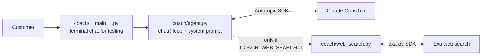
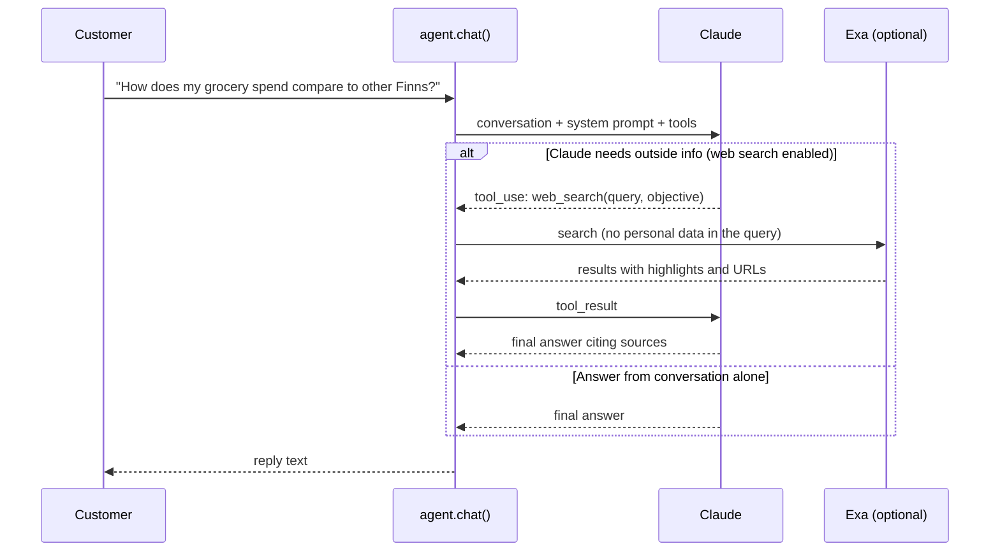
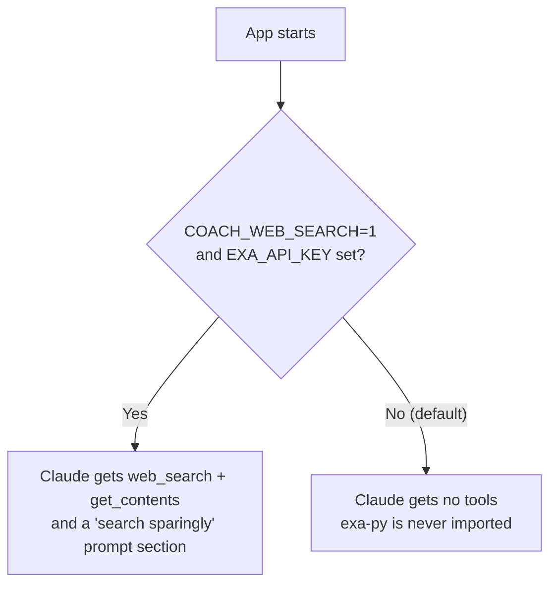

# mountain-claude-boys-trek
Junction 2026 project repo for Mountain Claude Boys team
This project is for the Junction 2026 S-Pankki challenge. Full challenge description: [CHALLENGE.md](CHALLENGE.md). Tech stack plan: [TECH_STACK.md](TECH_STACK.md)

From the challenge description:

"The Challenge
Explore how AI can turn personal banking data into a trusted financial coach for everyday life.

S-Bank is Finland’s fourth-largest bank, with 3.5 million customers, and its S-mobiili app is used weekly by one in three Finnish adults. We want to reimagine personal finance by letting people talk with their own financial data through AI. Banking today often stops at statements and transaction lists. We want to make it conversational, insightful, and personalised. At Junction, we invite you to help us build the next generation of AI-driven personal economic trainers that make money matters simple and engaging for everyone.

Using a large synthetic transaction dataset modelled on real S-Bank data, build an AI experience that lets people chat with their own money, from simple questions like “How much did I spend on taxis last month?” to deeper ones like “What kind of spender am I?”, “What is safe for me to spend this week?” or “How much could I save if I reduced dining out by 20%?”.

We value a pedagogical angle: everyone’s spending falls into three baskets:

mandatory and regular (e.g. rent)
mandatory and irregular (e.g. a broken washing machine), and
everyday spending that slips through your fingers (e.g. coffees) — and solutions that help people understand where their money really goes will go far with us.
Think in the spirit of MyData: let users explore their own data freely rather than showing fixed charts the bank has picked for them. You can enhance these insights with open data sources (e.g., Statistics Finland) to offer meaningful benchmarks.

Recommended output: a mobile app, or a web app that can be embedded in a mobile app — our customers are on mobile.

Extra details: To our knowledge, no Finnish bank yet lets customers chat with their own financial data, making this a first-of-its-kind opportunity in Finnish banking. The challenge ties directly to S- Bank’s strategy of serving customers increasingly digitally and to our vision for S-mobiili. One of the top-rated finance apps on both Google Play and the App Store, so a winning idea could reach millions of people. Money matters touch everyone, and we believe AI can play a key role in improving financial literacy — especially among young adults.

About the Company S-Bank is Finland’s fourth-largest bank, serving 3.5 million customers nationwide. Our mission is to make everyday banking simple, rewarding, and accessible to everyone. We believe in combining strong financial expertise with innovative technology to create solutions that genuinely improve people’s lives. Junction offers us a unique opportunity to co-create with some of the world’s brightest developers and to explore new ways AI can reshape personal finance."

---

## What we've built so far

A chat backend for the finance coach. Claude does the coaching. Web search through [Exa](https://exa.ai) is an **optional** extra for outside information (Statistics Finland benchmarks, prices, interest rates, Kela, taxes) and is **off by default**.



| File | Purpose |
|---|---|
| `coach/agent.py` | The coach: system prompt (three spending baskets) and the chat loop that talks to Claude |
| `coach/web_search.py` | Optional Exa tools (`web_search`, `get_contents`) plus the prompt text that tells Claude when to use them |
| `coach/__main__.py` | Terminal chat for trying the coach: `python -m coach` |
| `requirements.txt` | Python dependencies (`exa-py` is only needed with web search) |
| `.env.example` | Template for API keys and settings |

### How one chat turn works

`chat(messages)` sends the conversation to Claude. If Claude asks for a tool, such as a web search, the loop runs the tool, sends the result back, and repeats until Claude gives a final answer (at most 10 rounds).



### Web search on or off



The search prompt tells Claude to search only when outside facts genuinely help, to prefer official Finnish sources and cite URLs, and **never to put a customer's personal or financial details into a search query**.

## Setup

Requires Python 3.10+.

1. Create a virtual environment and install dependencies:
   ```bash
   python3 -m venv .venv
   .venv/bin/pip install -r requirements.txt
   ```
2. Create your env file:
   ```bash
   cp .env.example .env
   ```
3. In `.env`, set `ANTHROPIC_API_KEY` (get one at [console.anthropic.com](https://console.anthropic.com)). Usage is billed per request.
4. Optional web search: set `COACH_WEB_SEARCH=1` and `EXA_API_KEY` (from [dashboard.exa.ai](https://dashboard.exa.ai)).
5. Try it:
   ```bash
   .venv/bin/python -m coach
   ```

> **Never commit `.env` or share keys in chat.** `.env` and `.venv/` are already in `.gitignore`. If a key leaks, revoke it in that service's console.

## Next steps

- Add tools that let Claude query the synthetic transaction dataset, registered next to the Exa tools in `coach/agent.py`.
- Wrap `chat()` in a web API (e.g. FastAPI) for the mobile front end.
