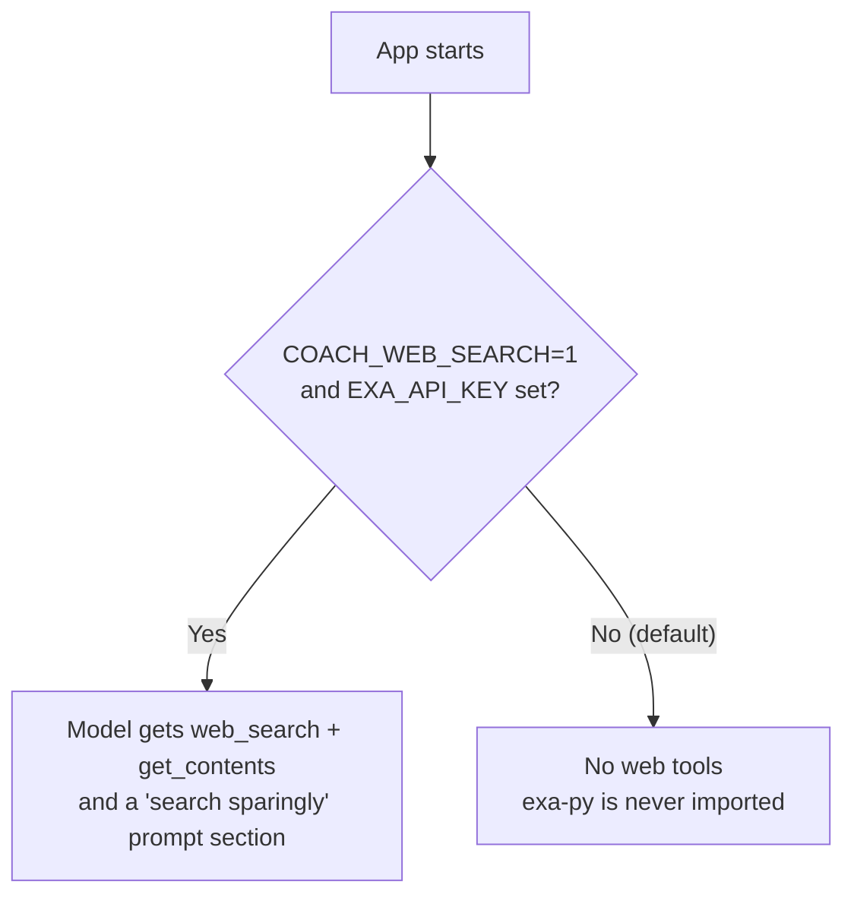

# Developer Setup

For the Mountain Claude Boys team. The [README](README.md) is the public, grader-facing overview; this file is how we build and run the project.

Related docs: [CHALLENGE.md](CHALLENGE.md) (the brief) · [TECH_STACK.md](TECH_STACK.md) (plan, build order, submission checklist)

## 1. Python environment

Requires Python 3.10+.

```bash
python3 -m venv .venv
.venv/bin/pip install -r requirements.txt
```

Re-run the `pip install` line whenever `requirements.txt` changes after a pull.

## 2. Settings and keys

```bash
cp .env.example .env
```

Fill in `.env`:

| Setting | Required | Where to get it |
|---|---|---|
| `ANTHROPIC_API_KEY` | Yes, for now | [console.anthropic.com](https://console.anthropic.com) (Junction gives $20 of credits per person) |
| `DATABASE_URL` | Yes | Service URI of the shared Aiven database from the Aiven console, or a local PostgreSQL (see step 4) |
| `COACH_WEB_SEARCH` | No | `1` turns on optional Exa web search; default `0` |
| `EXA_API_KEY` | Only with web search | [dashboard.exa.ai](https://dashboard.exa.ai) |

> **Never commit `.env` or paste keys or the Aiven URI in chat.** `.env`, `.venv/` and `data/` are in `.gitignore`. If a key leaks, revoke it in that service's console.

## 3. Get the data (only for a local database)

Skip this if you only use the shared Aiven database: the data is already loaded there.

The S-Pankki CSVs live in [hackjunction/Junction-2026-S-pankki](https://github.com/hackjunction/Junction-2026-S-pankki). Download them into `data/` (ignored by git):

```bash
mkdir -p data
# Transactions: stored in Git LFS, so it needs the media URL
curl -fL -o data/tx_junction_transactions.csv \
  https://media.githubusercontent.com/media/hackjunction/Junction-2026-S-pankki/main/tx_junction_transactions.csv
# The other three are regular files
for f in tx_customers_junction.csv mtg_negotiation_history.csv mtg_tx_customer_link_and_final_mtg_infio.csv; do
  curl -fL -o data/$f https://raw.githubusercontent.com/hackjunction/Junction-2026-S-pankki/main/$f
done
```

Check it worked:

```bash
ls -l data/                                   # transactions file should be ~363 MB
head -c 100 data/tx_junction_transactions.csv # CSV columns, not "version https://git-lfs..."
```

## 4. Database

### Shared Aiven database (what the team uses)

**Already set up and loaded** with all the data:

| | |
|---|---|
| Service | `pg-2a3bcedc` in the `mountain-claude-boys` Aiven organization |
| Version / plan | PostgreSQL 18.7, Developer-1 (1 CPU, 1 GB RAM, 8 GB storage, max 15 connections) |
| Region | DigitalOcean Frankfurt, Germany (EU) |
| Data | All four tables loaded, 628 MB |

To connect:

1. Accept the Aiven invite email. If you haven't got one, ask a teammate with admin access to invite you (Admin → Users → Invite users, then project → Permissions → Grant permissions, role **Developer**).
2. In the Aiven console, open `pg-2a3bcedc` and copy the **Service URI** (`postgres://avnadmin:…@….aivencloud.com:…/defaultdb?sslmode=require`).
3. Put it in your `.env` as `DATABASE_URL`. Don't paste it in chat or commit it.
4. **Don't run the loader** against this database. It refuses if the tables exist, and `--replace` would wipe and reload the shared data (about 7 minutes of downtime for everyone), so only do that if the team agrees.

Queries take roughly 50–100 ms from a laptop, almost all of it network time to Frankfurt.

If the database ever has to be recreated: create a PostgreSQL service in an EU region with at least 2 GB of disk, download the data (step 3), set `DATABASE_URL`, and run `.venv/bin/python scripts/load_data.py`. Loading into Aiven takes about 7 minutes, mostly uploading the 363 MB file.

### Local database (optional)

Useful for working offline or experimenting without touching the shared data. Install PostgreSQL (e.g. `sudo apt install postgresql` on Ubuntu/WSL, or run it in Docker), create a database, point `DATABASE_URL` at it, and run the loader. A local load takes about 30 seconds.

### Tables

| Table | Rows | Contents |
|---|---|---|
| `customers` | 5,100 | `customer_id`, `postal_code`, `age` |
| `transactions` | 3,626,755 | Oct 2024 – Sep 2026; `customer_id, bank_account_id, tx_date, tx_timestamp, category, tx_amount_eur, balance_after_eur, transaction_type, merchant_id, mcc_code` |
| `mortgage_outcomes` | 200 | Final outcome per mortgage application, linked to `customer_id` |
| `mortgage_events` | 3,452 | Mortgage application event history (Jan – Sep 2026) |

Negative `tx_amount_eur` is money out. "Salary Sweep" and "Invest Withdraw" look like transfers between accounts rather than spending (to confirm with the S-Bank mentors).

## 5. Run the coach

```bash
.venv/bin/python -m coach --customer CUST00001
```

A terminal chat for testing. `--customer` sets which customer's transactions the coach may read (or set `COACH_CUSTOMER_ID` in `.env`). Without it the coach has no access to any customer data. Ctrl+D quits.

Run the tests that need no database with `.venv/bin/python -m pytest tests/test_calculations.py tests/test_spending_baskets.py tests/test_database_queries.py tests/test_spending_tools.py`. Name the files: the other files in `tests/` are audit scripts that query the live database when imported.

## Project layout

| Path | Purpose |
|---|---|
| `coach/agent.py` | The coach: system prompt (three spending baskets) and the chat loop with tool calls |
| `coach/web_search.py` | Optional Exa tools, only loaded when `COACH_WEB_SEARCH=1` |
| `coach/spending_baskets.py` | What counts as spending, and which basket each category belongs to |
| `coach/calculations.py` | Safe-to-spend, safe-to-save and what-if maths: plain Python, no database or model |
| `coach/database/` | PostgreSQL connection and the SQL queries |
| `coach/tools/spending.py` | The customer-scoped tools the model calls (data tools plus the calculations) |
| `coach/__main__.py` | Terminal chat: `python -m coach` |
| `scripts/load_data.py` | Loads `data/*.csv` into PostgreSQL (`DATABASE_URL`) |
| `requirements.txt` | Python dependencies |
| `.env.example` | Template for `.env` |

### How a chat turn works

`chat(messages)` sends the conversation to the model. If the model asks for a tool, the loop runs it, sends the result back, and repeats until there's a final answer (at most 10 rounds). Today the model is Claude. When a customer is set, it also gets seven spending tools scoped to that customer (three data tools and four calculations, see `coach/tools/spending.py`) next to the optional Exa ones. Gemma on Verda is next (see the build order in [TECH_STACK.md](TECH_STACK.md)).



## Next steps

- Make the model a setting so we can compare Claude and Gemma 4.
- FastAPI web API for the mobile front end.
