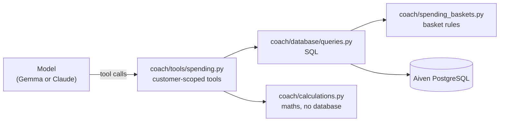

# Developer Setup

For the Mountain Claude Boys team. The [README](README.md) is the public, grader-facing overview; this file is how we build and run the project.

Related docs: [CHALLENGE.md](CHALLENGE.md) (the brief) · [TECH_STACK.md](TECH_STACK.md) (plan, build order, submission checklist) · [BASKETS.md](BASKETS.md) (proposed spending-basket rules)· [FINE_TUNING.md](FINE_TUNING.md) (fine-tuning plan, test set and training data) · [POLICY.md](POLICY.md) (what the coach answers and declines) · [DATA.md](DATA.md) (what's in the data: categories, merchant types, amounts, timing; regenerate with `.venv/bin/python scripts/profile_data.py`)

## 1. Python environment

Requires Python 3.10+.

```bash
python3 -m venv .venv
.venv/bin/pip install -r requirements.txt
```

Re-run the `pip install` line whenever `requirements.txt` changes after a pull.

## 2. Settings and keys

```bash
cp .env.example .env
```

Fill in `.env`:

| Setting | Required | Where to get it |
|---|---|---|
| `COACH_TODAY` | No | Demo date, e.g. `2026-09-18`: the coach treats it as "today" and never shows data after it. Empty = the customer's last data date (30 Sep 2026) |
| `COACH_MODEL` | No | `gemma` (default in `.env.example`, the product) or `claude` (development / comparison). Code default if unset: `claude` |
| `VERDA_BASE_URL` | With `gemma` | `https://containers.datacrunch.io/gemma-coach/v1` (see step 5) |
| `VERDA_API_KEY` | With `gemma` | Verda console → **Credentials** → **Inference API Keys** → **Create** (ask the teammate who owns Verda) |
| `ANTHROPIC_API_KEY` | With `claude` | [console.anthropic.com](https://console.anthropic.com) (Junction gives $20 of credits per person) |
| `DATABASE_URL` | Yes | Service URI of the shared Aiven database from the Aiven console, or a local PostgreSQL (see step 4) |
| `COACH_WEB_SEARCH` | No | `1` turns on optional Exa web search; default `0` |
| `EXA_API_KEY` | Only with web search | [dashboard.exa.ai](https://dashboard.exa.ai) |

> **Never commit `.env` or paste keys or the Aiven URI in chat.** `.env`, `.venv/` and `data/` are in `.gitignore`. If a key leaks, revoke it in that service's console.

## 3. Get the data (only for a local database)

Skip this if you only use the shared Aiven database: the data is already loaded there.

The S-Pankki CSVs live in [hackjunction/Junction-2026-S-pankki](https://github.com/hackjunction/Junction-2026-S-pankki). Download them into `data/` (ignored by git):

```bash
mkdir -p data
# Transactions: stored in Git LFS, so it needs the media URL
curl -fL -o data/tx_junction_transactions.csv \
  https://media.githubusercontent.com/media/hackjunction/Junction-2026-S-pankki/main/tx_junction_transactions.csv
# The other three are regular files
for f in tx_customers_junction.csv mtg_negotiation_history.csv mtg_tx_customer_link_and_final_mtg_infio.csv; do
  curl -fL -o data/$f https://raw.githubusercontent.com/hackjunction/Junction-2026-S-pankki/main/$f
done
```

Check it worked:

```bash
ls -l data/                                   # transactions file should be ~363 MB
head -c 100 data/tx_junction_transactions.csv # CSV columns, not "version https://git-lfs..."
```

## 4. Database

### Shared Aiven database (what the team uses)

**Already set up and loaded** with all the data:

| | |
|---|---|
| Service | `pg-2a3bcedc` in the `mountain-claude-boys` Aiven organization |
| Version / plan | PostgreSQL 18.7, Developer-1 (1 CPU, 1 GB RAM, 8 GB storage, max 15 connections) |
| Region | DigitalOcean Frankfurt, Germany (EU) |
| Data | All four tables loaded, 628 MB |

To connect:

1. Accept the Aiven invite email. If you haven't got one, ask a teammate with admin access to invite you (Admin → Users → Invite users, then project → Permissions → Grant permissions, role **Developer**).
2. In the Aiven console, open `pg-2a3bcedc` and copy the **Service URI** (`postgres://avnadmin:…@….aivencloud.com:…/defaultdb?sslmode=require`).
3. Put it in your `.env` as `DATABASE_URL`. Don't paste it in chat or commit it.
4. **Don't run the loader** against this database. It refuses if the tables exist, and `--replace` would wipe and reload the shared data (about 7 minutes of downtime for everyone), so only do that if the team agrees.

Queries take roughly 50–100 ms from a laptop, almost all of it network time to Frankfurt.

If the database ever has to be recreated: create a PostgreSQL service in an EU region with at least 2 GB of disk, download the data (step 3), set `DATABASE_URL`, and run `.venv/bin/python scripts/load_data.py`. Loading into Aiven takes about 7 minutes, mostly uploading the 363 MB file.

### Local database (optional)

Useful for working offline or experimenting without touching the shared data. Install PostgreSQL (e.g. `sudo apt install postgresql` on Ubuntu/WSL, or run it in Docker), create a database, point `DATABASE_URL` at it, and run the loader. A local load takes about 30 seconds.

### Tables

| Table | Rows | Contents |
|---|---|---|
| `customers` | 5,100 | `customer_id`, `postal_code`, `age` |
| `transactions` | 3,626,755 | Oct 2024 – Sep 2026; `customer_id, bank_account_id, tx_date, tx_timestamp, category, tx_amount_eur, balance_after_eur, transaction_type, merchant_id, mcc_code` |
| `mortgage_outcomes` | 200 | Final outcome per mortgage application, linked to `customer_id` |
| `mortgage_events` | 3,452 | Mortgage application event history (Jan – Sep 2026) |

Negative `tx_amount_eur` is money out. "Salary Sweep" and "Invest Withdraw" look like transfers between accounts rather than spending (to confirm with the S-Bank mentors).

## 5. Gemma on Verda

The coach's model, Google's Gemma 4 31B, runs in our own vLLM container on Verda:

| | |
|---|---|
| Deployment | `gemma-coach`, Verda Serverless Containers, On-Demand, Continuous |
| URL | `https://containers.datacrunch.io/gemma-coach/v1` (OpenAI-compatible `/v1/chat/completions`) |
| Model name in requests | `gemma-coach` |
| Hardware | 1× H100 SXM5 80 GB |
| Cost | **€5.15 per hour while a replica is running**, starting from the moment it boots |
| Image | `docker.io/vllm/vllm-openai:v0.29.0` |

**Cost rule:** set **Min replicas to 0** in the deployment's scaling settings when nobody is using it (nights, long breaks), and back to **1** at least 20–30 minutes before anyone needs it (demo, judging). A cold start takes several minutes; the first request after scaling to zero waits for it. Tell the team in chat when you change it.

Quick check that it's up (replace the key):

```bash
curl -X POST https://containers.datacrunch.io/gemma-coach/v1/chat/completions \
  --header 'Authorization: Bearer <VERDA_API_KEY>' \
  --header 'Content-Type: application/json' \
  --data '{"model": "gemma-coach", "messages": [{"role": "user", "content": "Selitä lyhyesti, mikä on hätävara."}]}'
```

<details>
<summary>Redeploying from scratch</summary>

Prerequisite: a Hugging Face **Read** token (huggingface.co → profile picture → Access Tokens → Create new token → type **Read**, not fine-grained). If the model page asks you to accept a license, accept it first.

Verda console → Containers → New deployment:

| Field | Value |
|---|---|
| Deployment name | `gemma-coach` (becomes the URL; can't be changed later) |
| Deployment type / compute type | Continuous / On-Demand |
| Compute | 1x H100 SXM5 (`1H100.80S.21V`) |
| Image / tag | `docker.io/vllm/vllm-openai` / `v0.29.0` (the plain linux/amd64 one), public, image caching ON |
| Exposed HTTP port | `8000` (vLLM's port, **not** the default 80) |
| Healthcheck | ON, port `8000`, path `/health` |
| Entrypoint | empty |
| Environment variables | `HF_HOME` = `/data/.huggingface`, `HF_TOKEN` = your Hugging Face token |
| Scaling | Min 1 / Max 1, concurrent requests per replica 8, queue load Balanced |
| Storage | container disk `/data` (100 GiB is enough), SHM `/dev/shm` 8 GiB |

**CMD:** each row of the argument list is passed to vLLM as **one** argument, so a flag and its value must be on **separate rows** (or paste this into the command-line view `>_` and check the list view shows 13 rows):

```
--model google/gemma-4-31B-it --quantization fp8 --served-model-name gemma-coach --max-model-len 32768 --enable-auto-tool-choice --tool-call-parser gemma4 --reasoning-parser gemma4
```

Don't add `--gpu-memory-utilization 0.9`: it's vLLM's default anyway, and the form mangled the `0.9` value. `--quantization fp8` makes vLLM compress Google's weights to FP8 at load time so the 31B model fits on one H100.

First start takes 15–30 minutes (image pull, ~62 GB model download, FP8 compression). Ready when the logs show the server on port 8000 and the status is healthy.

| Log message | Fix |
|---|---|
| `unrecognized arguments` | A flag and its value share one CMD row; split them |
| `401` / `403` downloading | Wrong `HF_TOKEN`, or license not accepted on Hugging Face |
| `CUDA out of memory` | Lower `--max-model-len` to `16384` |
| Healthcheck failing | Exposed and healthcheck ports must both be `8000` |

</details>

## 6. Modal

Hosts the demo for phones and judges (step 12); planned for the what-if calculation Sandboxes too. Connect your machine once:

```bash
.venv/bin/modal setup        # opens the browser to log in
.venv/bin/modal profile current
```

The token is stored in your home directory, not in the project. Ask to be invited to the team's Modal workspace so you use the shared credits.

## 7. Run the coach

```bash
.venv/bin/python -m coach --customer CUST00001                 # any customer from CUST00001 to CUST05100
COACH_MODEL=claude .venv/bin/python -m coach --customer CUST00001   # override the model for one run
```

A terminal chat for testing. `--customer` sets which customer's transactions the coach may read (or set `COACH_CUSTOMER_ID` in `.env`). Without it the coach has no access to any customer data. Ctrl+D quits.

Questions to try (S-Bank's "Ask your money" plus our own): "Where did my money go last month?", "What can I safely spend this week?", "How much did I spend on taxis last month?", "Mihin rahani menevät? Jaa kulutukseni kolmeen koriin viime kuukaudelta.", "How much could I save per year if I cut restaurant spending by 20%?", "What kind of spender am I?"

The data ends on 30 September 2026, so by default the coach treats each customer's last transaction date as "today". That is the last day of a month, so for demos set a date mid-month, e.g. `COACH_TODAY=2026-09-10 .venv/bin/python -m coach --customer CUST00001`, to show a month in progress.

## 8. Tests

```bash
.venv/bin/python -m pytest
```

Unit tests need no database or model: a fake connection stands in for PostgreSQL. Data audits that read the live database are scripts, not tests: see `scripts/audits/`.

## 9. Web API

```bash
.venv/bin/uvicorn coach.api:app --reload          # http://localhost:8000, try it at /docs
```

| Endpoint | What it returns |
|---|---|
| `POST /chat` | Body `{"customer_id": "CUST00001", "message": "...", "conversation_id": null}`. The answer streamed as server-sent events: `conversation` (`{"conversation_id"}`, send it back with the next message), `tool` (`{"name"}` while the coach looks something up), `chart` (a chart spec from `coach/charts.py` to draw above the answer), `text` (`{"text"}`, pieces of the answer in order), `error`, `done`. |
| `GET /customers/{id}/summary` | Spending in the three baskets, this month so far by default (`start_date`, `end_date` optional). |
| `GET /customers/{id}/budget` | The monthly budget and safe to spend this week (same as the coach's `get_safe_to_spend`). |
| `GET /customers/{id}/receipts` | The latest card purchases up to "today", newest first, each with its merchant type and basket (`limit`, default 30, at most 100). |
| `GET /health` | `{"ok": true, "model": "gemma", "passcode_required": false}`. Always open. |
| `GET /passcode` | 200 if the `X-Demo-Passcode` header is right, else 401 (the login screen uses it). |

With `DEMO_PASSCODE` set (the hosted demo, step 12), every endpoint except `/health` answers 401 without the `X-Demo-Passcode` header. **New endpoints that return data must add `dependencies=PROTECTED`.** Locally the variable is unset and nothing is checked; to try the login as in the demo, start the API with `DEMO_PASSCODE=test`.

`COACH_TODAY` and `COACH_MODEL` apply to the API too. At startup the API loads every customer's spending for the peer comparison in the background (about 10 seconds against Aiven, then cached), so the first "What kind of spender am I?" may wait for it. Conversations are kept in memory (a restart forgets them), and there is no login: fine for the demo, not for real customers.

## 10. Run the whole app (backend + frontend)

Needs Node.js 20+ for the frontend (`node --version`).

```bash
# Terminal 1: backend on http://localhost:8000
COACH_TODAY=2026-09-10 .venv/bin/uvicorn coach.api:app --reload

# Terminal 2: frontend on http://localhost:5173
cd frontend
npm install        # first time, and after package.json changes
npm run dev
```

Open http://localhost:5173 (on WSL, the Windows browser reaches it as localhost too). `?lang=fi` opens it in Finnish. The frontend forwards `/api/...` to the backend (`frontend/vite.config.ts`), so start the backend first. Make sure Verda's Min replicas is 1 (see step 5) or the chat waits for Gemma to start.

Demo customers (in the header's picker, chosen for `COACH_TODAY=2026-09-10`):

| Customer | Situation |
|---|---|
| CUST00226 (21) | Budget left, but cash is tight before payday: the coach says €68.23 this week, limited by cash |
| CUST00050 (23) | On track, about €203 a week |
| CUST00127 (24) | Everyday budget nearly used, about €59 a week |
| CUST00001 (63) | Older customer, for contrast |

Frontend code: `frontend/src/`. Visual design is in `styles/tokens.css` (colours, fonts, spacing; the font is Rubik, bundled in `styles/fonts.css` as an open-licence stand-in for S-Pankki's own S Bonus fonts) and `config/ui.config.ts` (optional sections on/off); all UI text in both languages is in `lib/i18n.ts`. Check with `npm run build` and `npm run lint`.

## 11. Open it on your phone

A phone can't reach `localhost` on your laptop (and WSL adds another network layer), so a [Cloudflare quick tunnel](https://developers.cloudflare.com/cloudflare-one/connections/connect-networks/do-more-with-tunnels/trycloudflare/) gives the frontend dev server a temporary public HTTPS address. No Cloudflare account is needed; it works on Android and iPhone, over Wi-Fi or mobile data, and code changes still reload live.

Install `cloudflared` once (no sudo; check the SHA-256 against the one listed in the [release notes](https://github.com/cloudflare/cloudflared/releases)):

```bash
mkdir -p ~/.local/bin
curl -fL -o ~/.local/bin/cloudflared \
  https://github.com/cloudflare/cloudflared/releases/download/2026.10.7/cloudflared-linux-amd64
chmod +x ~/.local/bin/cloudflared
```

With the backend and frontend running (step 10), in a third terminal:

```bash
~/.local/bin/cloudflared tunnel --no-autoupdate --url http://localhost:5173
```

It prints an address like `https://some-random-words.trycloudflare.com`: open that on the phone. The frontend's `/api` forwarding works through it, chat answers stream as usual, and `frontend/vite.config.ts` allows `*.trycloudflare.com` hosts.

- **The address changes every time** you restart the tunnel, and stops working when you stop it (Ctrl+C) or close the laptop.
- **Anyone with the address can use the app**, and every chat message runs Gemma on Verda (paid). Share it only with the team and stop the tunnel when you're done. For judging, use the hosted demo (step 12).
- Warnings about `ping_group_range` / ICMP are harmless: the tunnel doesn't need ping.

## 12. Hosted demo on Modal

The permanent demo, for phones and judges, at one address:

**https://arvon-johannes--financial-coach.modal.run**

- The app asks for a **demo passcode** on the login screen (stored on the phone after the first log-in). It isn't in the repo: ask Taneli. Without it the coach and customer data answer 401; the page itself loads.
- **Install it on a phone:** Android Chrome → ⋮ → *Install app* (it lands in the app drawer; drag it to the home screen). iPhone Safari → Share → *Add to Home Screen*. It opens full-screen like an app.
- It runs in Taneli's Modal workspace `arvon-johannes`, with `region="eu"`: the server is in the EU (12.6 ms to Aiven in Frankfurt). Requests enter through Modal's web gateway in the US (AWS us-east-1; Modal also answers at `….us-east.modal.run`), encrypted. Say "the data is stored, processed and handled by the model in the EU", never "nothing leaves the EU": see "Where the data goes" in [TECH_STACK.md](TECH_STACK.md#where-the-data-goes).

**Before a demo:**

1. Verda: set Min replicas to **1** at least 20–30 minutes before (step 5), or the first chat waits for Gemma to start.
2. Open the app a few minutes before: the server sleeps after 20 minutes without requests, and waking it (and preloading the peer comparison data) takes about 10–20 seconds.
3. Afterwards: Verda Min replicas back to **0**. Modal costs nothing while the server sleeps.

**How it's built:** `deploy/modal_app.py` serves the built frontend at `/` and the coach API at `/api` (the same path Vite forwards in development) from one server. There is only ever one container, because conversations live in its memory; a redeploy or a sleep forgets them. Pages are sent with `Cache-Control: no-cache` and the service worker always re-checks the page, so a redeploy reaches phones on their next visit.

**Settings** are two Modal secrets, never files in the image:

| Secret | Holds | Change it |
|---|---|---|
| `coach-env` | `DATABASE_URL`, `VERDA_BASE_URL`, `VERDA_API_KEY`, `COACH_MODEL`, `COACH_TODAY` | `.venv/bin/modal secret create coach-env --force KEY=value …` (all five; `--force` replaces the secret), then redeploy |
| `coach-passcode` | `DEMO_PASSCODE` (letters, digits and dashes) | `.venv/bin/modal secret create coach-passcode --force DEMO_PASSCODE=new-code`, then redeploy |

**Redeploy** after code changes (needs access to the workspace and `modal setup`, step 6):

```bash
(cd frontend && npm run build)               # the deploy uploads frontend/dist as it is
.venv/bin/modal deploy deploy/modal_app.py
```

To try changes first without touching the demo, `.venv/bin/modal serve deploy/modal_app.py` runs a temporary copy at `https://arvon-johannes--financial-coach-dev.modal.run`; Ctrl+C removes it.

**If a phone shows an old version** (for example after testing an older build): reload the page; if that doesn't help, clear the site's data (Chrome → Settings → Site settings → All sites → `modal.run`).

## Project layout

The AI never touches the database directly. It calls tools; the tools use the query layer for data and the calculations module for maths.



| Path | Purpose |
|---|---|
| `coach/agent.py` | The coach: system prompt (customer context) and the chat loops for Gemma (streaming) and Claude |
| `coach/api.py` | FastAPI web API for the front end |
| `coach/tools/spending.py` | The customer-scoped tools the model calls (data tools plus the calculations) |
| `coach/database/queries.py` | The SQL queries |
| `coach/database/connection.py` | One shared, read-only PostgreSQL connection |
| `coach/spending_baskets.py` | What counts as spending, and which basket each transaction belongs to |
| `coach/budget.py` | Monthly budget and safe to spend this week: gathers the customer's history and calls the calculations |
| `coach/peers.py` | "What kind of spender am I?": loads every customer's spending (cached) and calls the peer comparison in the calculations |
| `coach/charts.py` | The charts the coach can show (`show_chart`): builds each chart's data from the query layer, no numbers from the model |
| `coach/calculations.py` | Budget, safe-to-spend, safe-to-save, what-if and peer-comparison maths: plain Python, no database or model |
| `coach/web_search.py` | Optional Exa tools, only loaded when `COACH_WEB_SEARCH=1` |
| `coach/__main__.py` | Terminal chat: `python -m coach --customer CUST00001` |
| `frontend/` | React + Vite mobile web app (see step 10) |
| `frontend/src/components/` | Screens and parts: `LoginScreen`, `SmobiiliHome`, `ReceiptsPage` (real receipts), `CardCarousel` + `BasketCard` (swipeable cards above the chat), `Chat` + `ChatChart` (the coach and its charts) |
| `frontend/src/lib/merchants.ts` | Finnish and English names for merchant types, categories and baskets |
| `scripts/load_data.py` | Loads `data/*.csv` into PostgreSQL (`DATABASE_URL`) |
| `scripts/profile_data.py` | Regenerates [DATA.md](DATA.md) from the CSVs |
| `scripts/fetch_statfin.py` | Downloads Statistics Finland's household spending by age and writes `coach/statfin_data.py` (the open benchmark). Re-run to refresh; the app itself never calls Statistics Finland |
| `coach/statfin.py`, `coach/statfin_data.py` | The open benchmark: Finnish average spending per consumption unit by age, for Groceries, Restaurants, Transportation, Health and Entertainment (CC BY 4.0, "Source: Statistics Finland") |
| `scripts/audits/` | One-off data audits against the live database |
| `tests/` | Unit tests |
| `requirements.txt` | Python dependencies |
| `.env.example` | Template for `.env` |

### Coach tools

Each tool is bound to the customer the app chose when the tools were created; no tool accepts a customer ID, and unexpected arguments are rejected. See `coach/tools/spending.py` for the full descriptions the model sees.

| Tool | Answers questions like |
|---|---|
| `get_spending_by_category` | "How much did I spend on restaurants?" Spending per category with totals, monthly averages and counts. With a category: "How much on taxis?", that category split by merchant type. |
| `get_basket_summary` | "Where did my money go?" Spending in 🏠 🔧 ☕ with shares, categories and merchant types, large one-off purchases, and income, savings and salary sweeps shown separately. |
| `get_monthly_balance_trend` | "How has my balance changed?" End-of-month balance for recent months. |
| `get_transactions` | "What were my biggest purchases?" The largest or latest transactions, optionally for one category. |
| `get_safe_to_spend` | "What can I safely spend this week?" The monthly budget (income − 🏠 essentials − 🔧 reserve − savings = ☕ everyday budget), how much is left this month, and a cash check until the next payday. Computed in `coach/budget.py`. |
| `calculate_safe_to_save` | "How much could I save each month?" |
| `calculate_what_if` | "How much would I save if I cut dining out by 20%?" |
| `compare_with_peers` | "What kind of spender am I?" The customer against people their age and against all 5,100 customers, over the last 12 complete months: per category and per basket, the monthly amount, the peer median and typical range, and the share of peers who spend less or more. A profile lists the habits that stand out (rent and utilities left out). Where a category maps, also Statistics Finland's average for Finnish households of the same age (open data, `coach/statfin.py`). Only medians and ranks reach the model, never another customer's data. Computed in `coach/peers.py`. |
| `show_chart` | Not a question but a picture: the coach calls it when its answer compares numbers, and the app draws the chart above the answer. The model picks `kind` (`categories`, `trend`, `balance`, `budget`, `peers`, the last with an optional category for one category in detail) and the period, category or basket; every number is computed in `coach/charts.py`. At most one chart per answer. |

Basket rules: [BASKETS.md](BASKETS.md), implemented in `coach/spending_baskets.py`.

### How a chat turn works

`chat(messages, customer_id)` builds the system prompt (with the customer's age, data range and balance when a customer is set), sends the conversation to the model with the tools, runs any tool calls, sends the results back, and repeats until there's a final answer (at most 10 rounds).

## Next steps

- Run the calculations in Modal Sandboxes.
