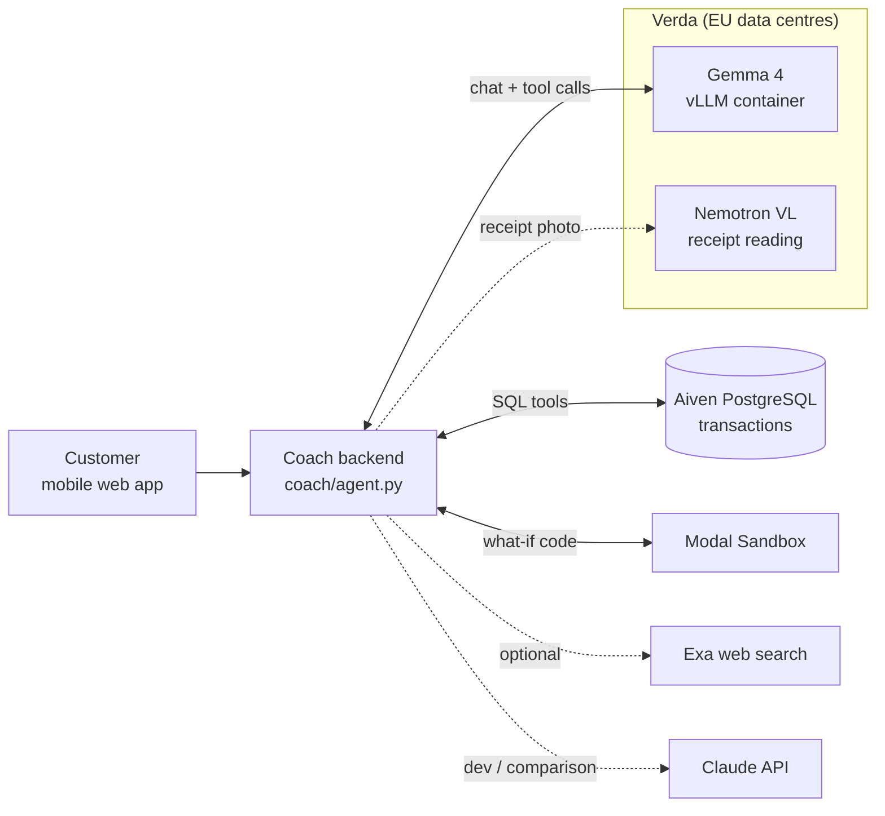
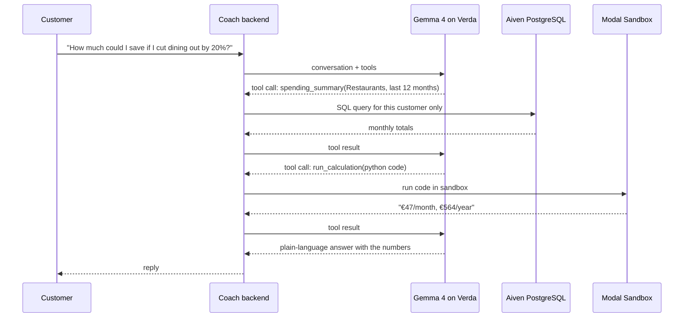

# Tech Stack Plan

Plan for our S-Pankki **Personal Economic Trainer** ([CHALLENGE.md](CHALLENGE.md)), combined with several Junction 2026 tech challenges.

> **Status:** in progress. Items marked ⚠️ are not verified yet. Setup details for developers are in [SETUP.md](SETUP.md).
> ⚠️ We heard teams can enter as many tech challenges as they like. Confirm with the organisers.

## Pitch in one line

An AI money coach that keeps customer data in Europe on open models, and **computes** its answers from the customer's own transactions instead of guessing them.

## Tech challenges we're targeting

| Priority | Challenge | What it does in our product | Prize |
|---|---|---|---|
| Core | **S-Pankki** (main) | The whole coach: chat with your own money, three spending baskets, safe-to-spend, what-if | Main challenge |
| Core | **Verda** | Hosts our open models (Gemma, possibly Nemotron) in EU data centres, so customer data never goes to an outside AI API | $10k / $2.5k / $2.5k credits |
| Core | **Gemma** | Gemma 4 is the coach's brain: chat, tool calls, explanations | €1,000 × 3 teams |
| Core | **Aiven** | PostgreSQL holds the transaction dataset; the coach queries it with tools | €1,000 / €750 / €500 |
| Core | **Modal** | Secure Sandboxes run the calculation code for what-if questions, so numbers are exact | $2,000 + $3,000 credits |
| Add-on | **Nemotron** | Reads receipt and bill photos and files them into the right basket | 2 × RTX 5080 |
| Add-on | **CRACI** | Our GitHub Actions CI runs on `runs-on: craci` | LEGO sets |
| Add-on | **Codex** | Only if a teammate builds part of the project with Codex | $10k / $5k / $2.5k API credits |
| Stretch | **ElevenLabs** | Voice mode for the coach | Earbuds |

**Skipped:** Gemini (third LLM, and a Google API conflicts with the "data in Europe" story), Oxylabs and Context.dev (need live web data at the core; web search stays optional), Tiger Data and MongoDB (duplicate the database), Vultr (duplicates compute), Entire, Solana, Cloudinary, Arduino, Atech (no natural fit).

## Architecture

Solid lines are the core flow. Dashed lines are optional or development-only.

## How a question gets answered

The model only ever sees one customer's query results, never the full dataset.

## Components

### Data: S-Pankki dataset → Aiven PostgreSQL

Source: [hackjunction/Junction-2026-S-pankki](https://github.com/hackjunction/Junction-2026-S-pankki)

| File | Contents |
|---|---|
| `tx_junction_transactions.csv` | 363 MB, 3,626,755 transactions, Oct 2024 – Sep 2026, Git LFS |
| `tx_customers_junction.csv` | 5,100 customers: postal code, age |
| `mtg_negotiation_history.csv` | 3,452 mortgage application events (Jan – Sep 2026) |
| `mtg_tx_customer_link_and_final_mtg_infio.csv` | 200 mortgage applications: customer link and final outcomes |

- Transaction columns: `customer_id, bank_account_id, tx_date, tx_timestamp, category, tx_amount_eur, balance_after_eur, transaction_type, merchant_id, mcc_code`.
- 15 categories already exist: Groceries, Restaurants, Transportation, Utilities, Entertainment, Health, Salary, Home & Tech, Housing, Lifestyle, Travel, Invest Deposit, Other Income, Salary Sweep, Invest Withdraw.
- Loaded with `scripts/load_data.py`: tables `customers`, `transactions`, `mortgage_outcomes`, `mortgage_events`, indexed by customer and date. The database takes **628 MB** including indexes, on an Aiven Developer-1 plan (8 GB storage) in Frankfurt. A per-customer query takes under a millisecond in the database, about 50–100 ms from a laptop including network.
- The CSVs start with a UTF-8 BOM: read with `utf-8-sig`.
- The transactions file is in Git LFS: clone with `git lfs install` first, or GitHub's "Download ZIP" may give only a pointer file.
- **Three baskets** come from a category mapping in `coach/db.py` (draft: Housing, Utilities, Groceries, Transportation → mandatory regular; Health, Home & Tech → mandatory irregular; Restaurants, Entertainment, Lifestyle, Travel → everyday; income, savings and transfers are not spending). Merchant codes split categories further, e.g. Transportation → taxi, fuel, parking, public transport.

### Coach model: Gemma 4 on Verda

- Verda's ready-made Inference API offers only Kimi K3.1 Pro and DeepSeek V4.1 Flash. **No Gemma**, so we self-host Gemma with vLLM on Verda Serverless Containers (OpenAI-style `/v1/chat/completions` endpoint, per-minute billing, scale to zero).
- Gemma 4 sizes: E2B, E4B, 12B, 26B A4B (MoE, ~4B active, fast), **31B** (dense, strongest). Gemma 4 is the latest generation; there is no Gemma 5.
- **We run Google's official `google/gemma-4-31B-it`**, compressed to FP8 by vLLM at load time so it fits on **1× H100 80 GB** (€5.15/h). Chosen over 26B A4B for tool use: Google's Tau2 agentic benchmark gives 31B 76.9% vs 68.2% for 26B A4B.
- **Tested (Nov 14):** correct tool calls and numbers in English and Finnish (checked against SQL), natural Finnish, about 64 tokens/s, 2–5 s per answer including database lookups. No fine-tuning needed for Finnish.
- Container settings, cost rule (scale to 0 when idle) and redeploy steps: [SETUP.md § 5](SETUP.md#5-gemma-on-verda).
- ⚠️ Data-centre country for Verda containers is not shown in the console. Ask at the Verda booth.

### Fallback and comparison model: Claude API

- `COACH_MODEL=claude` switches the coach to Claude Opus 5.5 with the same tools.
- Kept for development and as a quality baseline to test Gemma against.
- Budget: $20 of Claude credits per person.

### Calculations: Modal Sandboxes

- The coach writes short Python for what-if and safe-to-spend maths; it runs in an isolated Modal Sandbox and returns exact numbers.
- Modal can also host the backend at a public URL for the demo if we don't host it on Verda.
- ⚠️ Modal's data region is not checked; send only aggregated numbers, not raw transactions.

### Receipts: Nemotron 3.5 Super VL (add-on)

- Customer photographs a receipt or surprise bill; Nemotron extracts amount, merchant and category, and the coach files it under "mandatory and irregular" where it fits.
- For development: NVIDIA Build's free hosted API (rate-limited, OpenAI-compatible). For the demo: ideally hosted on Verda to keep the EU story. It's a 120B model, so this needs a large GPU.

### Peer comparison: "What kind of spender am I?"

- The `compare_with_peers` tool compares a customer with people their age and with all 5,100 customers over the last 12 complete months, per category and per basket: monthly amount, peer median and typical range (25th–75th percentile), and the share of peers who spend less or more.
- **Age groups** are Statistics Finland's household budget survey bands (18–24, 25–34, …, 65–74, 75+), so they line up with official benchmarks if we add them. Smallest group: 75+ with 130 customers.
- A **profile** lists the habits that stand out (top or bottom quarter of the age group). Rent and utilities stay in the comparison but out of the profile: they reflect living situation, not habits.
- **Privacy:** the model only sees medians and ranks, never another customer's data.
- **How:** one query (`population_spending`) totals every customer's spending per category and basket. Baskets are placed in SQL with a lookup table generated from the Python rules, so the rules live only in `coach/spending_baskets.py`. It takes about 10 s on the Developer-1 plan, so the API loads it in the background at startup and caches it. Maths in `coach/calculations.py`, wiring in `coach/peers.py`.

### Optional: Exa web search

- Already built in `coach/web_search.py`, off by default (`COACH_WEB_SEARCH=1` to enable).
- For outside facts like Statistics Finland benchmarks. Never sent personal data.

## Build order

1. **Data:** ✅ done. Aiven PostgreSQL 18 (Frankfurt, Developer-1 plan) loaded with all 3.6M transactions via `scripts/load_data.py`.
2. **Tools:** ✅ done. Eight customer-scoped tools in `coach/tools/spending.py`, on a read-only query layer (`coach/database/queries.py`) and the basket rules (`coach/spending_baskets.py`), including safe-to-spend and the peer comparison.
3. **Model switch:** ✅ done. `COACH_MODEL=gemma|claude`. Next: a fixed set of 10–20 questions from the brief to compare models and catch regressions.
4. **Gemma on Verda:** ✅ done. `gemma-coach` container running Gemma 4 31B (FP8), tested in English and Finnish.
4b. **Web API:** ✅ done. FastAPI in `coach/api.py` with a streamed chat (see [SETUP.md § 9](SETUP.md#9-web-api)).
5. **Calculations:** ✅ done in plain Python (`coach/calculations.py`, `coach/budget.py`, `coach/peers.py`). Next: run them in Modal Sandboxes.
6. **Front end:** ✅ first version in `frontend/` (React + Vite): live cards, streamed chat, English and Finnish. Polish in progress.
7. **Add-ons:** Nemotron receipts, CRACI CI, ElevenLabs voice if time allows.

The S-Pankki challenge is the main prize: a polished coach beats many half-working integrations. Stop adding challenges if the core isn't solid.

## Open questions

- [ ] Can teams enter multiple tech challenges? (Organisers)
- [ ] Verda data-centre country. (Verda booth) GPU types and prices are known: 1× H100 at €5.15/h.
- [x] Is Gemma 4 reliable enough at tool calls? Yes: 31B FP8 passed the first English and Finnish tests.
- [ ] Where does the demo backend run? (Modal, Aiven or Verda)
- [ ] Gemma challenge submission requirements. (Google DeepMind booth / Discord)
- [ ] Are "Salary Sweep" and "Invest Withdraw" transfers between accounts rather than spending? (S-Bank data scientist mentor)
- [ ] Who on the team owns which component?

## Submission checklist

- [ ] **S-Pankki:** main submission (repo + demo).
- [ ] **Verda:** document the process; post a summary link in Verda's Discord channel.
- [ ] **Gemma:** confirm requirements.
- [ ] **Aiven:** show what the Aiven service enables in the demo.
- [ ] **Modal:** show Modal doing real work in the demo.
- [ ] **Nemotron:** text in the submission form naming the model, what it does, why it matters, and how we improved its outputs.
- [ ] **CRACI:** CI workflow running on `runs-on: craci`.
- [ ] **Codex:** show how Codex was used, if used.
