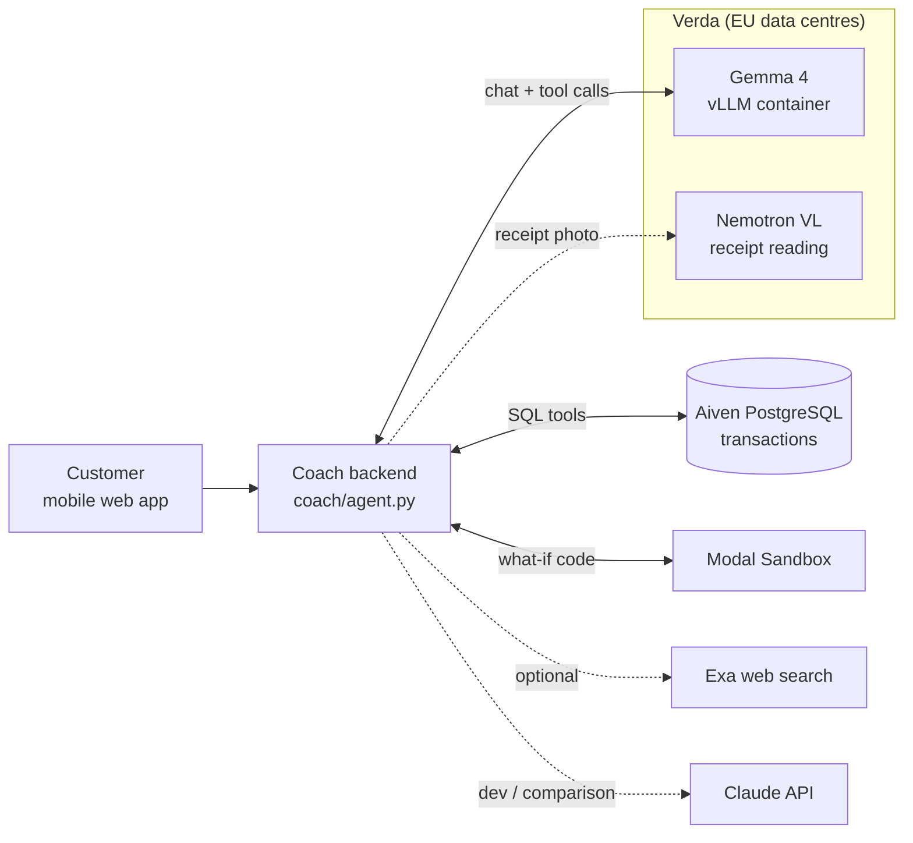
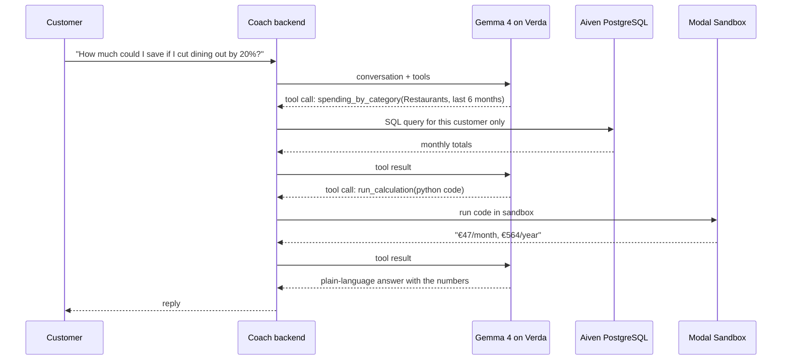

# Tech Stack Plan

Plan for our S-Pankki **Personal Economic Trainer** ([CHALLENGE.md](CHALLENGE.md)), combined with several Junction 2026 tech challenges.

> **Status:** draft plan. Items marked ⚠️ are not verified yet.
> ⚠️ We heard teams can enter as many tech challenges as they like. Confirm with the organisers.

## Pitch in one line

An AI money coach that keeps customer data in Europe on open models, and **computes** its answers from the customer's own transactions instead of guessing them.

## Tech challenges we're targeting

| Priority | Challenge | What it does in our product | Prize |
|---|---|---|---|
| Core | **S-Pankki** (main) | The whole coach: chat with your own money, three spending baskets, safe-to-spend, what-if | Main challenge |
| Core | **Verda** | Hosts our open models (Gemma, possibly Nemotron) in EU data centres, so customer data never goes to an outside AI API | $10k / $2.5k / $2.5k credits |
| Core | **Gemma** | Gemma 4 is the coach's brain: chat, tool calls, explanations | €1,000 × 3 teams |
| Core | **Aiven** | PostgreSQL holds the transaction dataset; the coach queries it with tools | €1,000 / €750 / €500 |
| Core | **Modal** | Secure Sandboxes run the calculation code for what-if questions, so numbers are exact | $2,000 + $3,000 credits |
| Add-on | **Nemotron** | Reads receipt and bill photos and files them into the right basket | 2 × RTX 5080 |
| Add-on | **CRACI** | Our GitHub Actions CI runs on `runs-on: craci` | LEGO sets |
| Add-on | **Codex** | Only if a teammate builds part of the project with Codex | $10k / $5k / $2.5k API credits |
| Stretch | **ElevenLabs** | Voice mode for the coach | Earbuds |

**Skipped:** Gemini (third LLM, and a Google API conflicts with the "data in Europe" story), Oxylabs and Context.dev (need live web data at the core; web search stays optional), Tiger Data and MongoDB (duplicate the database), Vultr (duplicates compute), Entire, Solana, Cloudinary, Arduino, Atech (no natural fit).

## Architecture

Solid lines are the core flow. Dashed lines are optional or development-only.

## How a question gets answered

The model only ever sees one customer's query results, never the full dataset.

## Components

### Data: S-Pankki dataset → Aiven PostgreSQL

Source: [hackjunction/Junction-2026-S-pankki](https://github.com/hackjunction/Junction-2026-S-pankki)

| File | Contents |
|---|---|
| `tx_junction_transactions.csv` | ~363 MB, about 3.6M transactions (estimated), Git LFS |
| `tx_customers_junction.csv` | 5,100 customers: postal code, age |
| `mtg_negotiation_history.csv` | Mortgage application events |
| `mtg_tx_customer_link_and_final_mtg_infio.csv` | Mortgage ↔ customer link and outcomes |

- Transaction columns: `customer_id, bank_account_id, tx_date, tx_timestamp, category, tx_amount_eur, balance_after_eur, transaction_type, merchant_id, mcc_code`.
- Categories already exist (Groceries, Restaurants, Utilities, Housing, Salary, Health, Entertainment, Transportation, Lifestyle, Travel, Home & Tech, Invest Deposit).
- The CSVs start with a UTF-8 BOM: read with `utf-8-sig`.
- The transactions file is in Git LFS: clone with `git lfs install` first, or GitHub's "Download ZIP" may give only a pointer file.
- **Three baskets** come mostly from rules on `category` and `transaction_type` (e.g. Housing, Utilities → mandatory regular; Restaurants, Entertainment → everyday), with the model handling edge cases like Health or Home & Tech.

### Coach model: Gemma 4 on Verda

- Verda's ready-made Inference API offers only Kimi K3.1 Pro and DeepSeek V4.1 Flash. **No Gemma**, so we self-host Gemma with vLLM on Verda Serverless Containers (OpenAI-style `/v1/chat/completions` endpoint, per-minute billing, scale to zero).
- Gemma 4 sizes: E2B, E4B, 12B, **26B A4B** (MoE, ~4B active, fast), **31B** (dense, strongest). 256K context on the larger models, native tool use and JSON output, image input.
- Start with **26B A4B**; try **31B** if answer quality is lacking.
- ⚠️ GPU types, prices and data-centre countries for Verda containers are not in their docs. Ask at the Verda booth.
- ⚠️ Gemma 4's tool-calling quality is untested for our use case.

### Fallback and comparison model: Claude API

- Current code (`coach/agent.py`) runs on Claude Opus 5.5.
- Kept as a switchable model for development and as a quality baseline to test Gemma against.
- Budget: $20 of Claude credits per person.

### Calculations: Modal Sandboxes

- The coach writes short Python for what-if and safe-to-spend maths; it runs in an isolated Modal Sandbox and returns exact numbers.
- Modal can also host the backend at a public URL for the demo if we don't host it on Verda.
- ⚠️ Modal's data region is not checked; send only aggregated numbers, not raw transactions.

### Receipts: Nemotron 3.5 Super VL (add-on)

- Customer photographs a receipt or surprise bill; Nemotron extracts amount, merchant and category, and the coach files it under "mandatory and irregular" where it fits.
- For development: NVIDIA Build's free hosted API (rate-limited, OpenAI-compatible). For the demo: ideally hosted on Verda to keep the EU story. It's a 120B model, so this needs a large GPU.

### Optional: Exa web search

- Already built in `coach/web_search.py`, off by default (`COACH_WEB_SEARCH=1` to enable).
- For outside facts like Statistics Finland benchmarks. Never sent personal data.

## Build order

1. **Data:** load the CSVs into PostgreSQL (local first, then Aiven).
2. **Tools:** give the coach 2–3 database tools (spending by category and period, basket summary, balance trend), scoped to one customer.
3. **Model switch:** make the model a setting; run the same 10–20 questions from the brief through Claude and Gemma 4 to compare.
4. **Gemma on Verda:** deploy the vLLM container, point the coach at it.
5. **Modal Sandboxes:** what-if and safe-to-spend calculations.
6. **Front end:** mobile-friendly web chat calling the backend.
7. **Add-ons:** Nemotron receipts, CRACI CI, ElevenLabs voice if time allows.

The S-Pankki challenge is the main prize: a polished coach beats many half-working integrations. Stop adding challenges if the core isn't solid.

## Open questions

- [ ] Can teams enter multiple tech challenges? (Organisers)
- [ ] Verda container GPU types, prices and data-centre countries. (Verda booth)
- [ ] Is Gemma 4 26B / 31B reliable enough at tool calls? (Test in step 3)
- [ ] Gemma challenge submission requirements. (Google DeepMind booth / Discord)
- [ ] Who on the team owns which component?

## Submission checklist

- [ ] **S-Pankki:** main submission (repo + demo).
- [ ] **Verda:** document the process; post a summary link in Verda's Discord channel.
- [ ] **Gemma:** confirm requirements.
- [ ] **Aiven:** show what the Aiven service enables in the demo.
- [ ] **Modal:** show Modal doing real work in the demo.
- [ ] **Nemotron:** text in the submission form naming the model, what it does, why it matters, and how we improved its outputs.
- [ ] **CRACI:** CI workflow running on `runs-on: craci`.
- [ ] **Codex:** show how Codex was used, if used.
